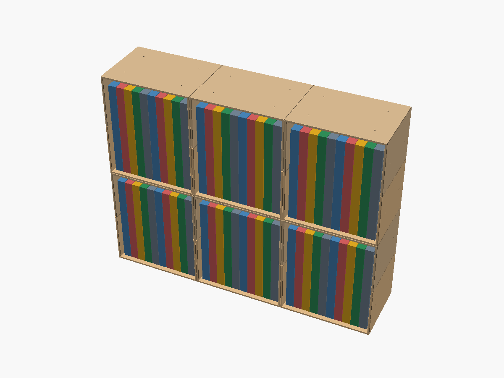
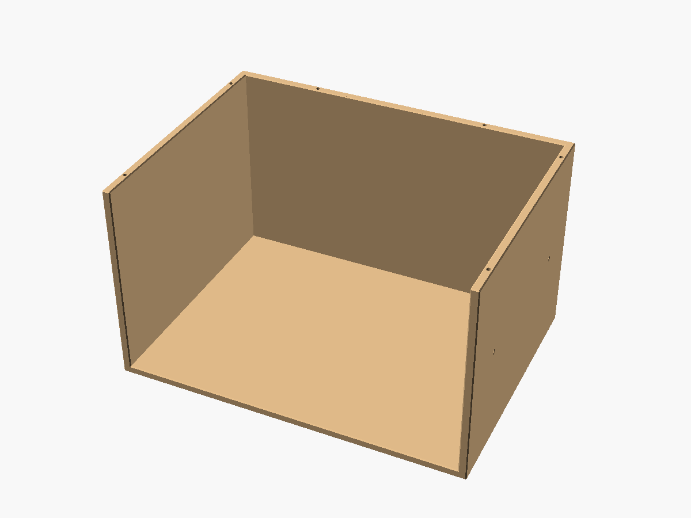
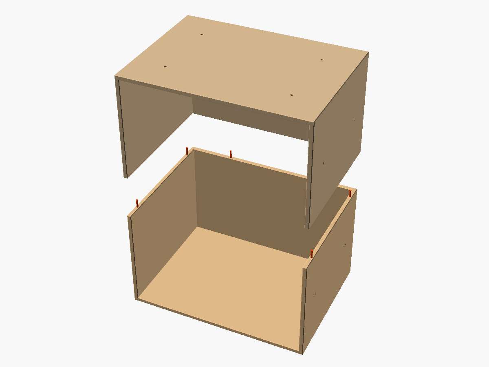
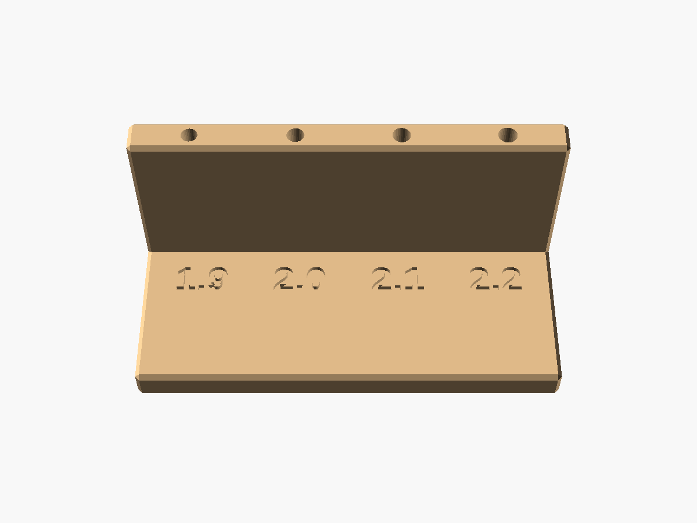

# 新書判コミック用モジュール本棚

新書判のコミック（112×174mm）を収納する本棚を、Bambu Lab A1 mini（造形範囲 180×180×180mm）で印刷できる部品に分割したものである。
1マスに約10冊が入り、マスを縦横に並べて大きさを変えられる。
モデルは OpenSCAD で記述しており、本のサイズや壁の厚さはパラメータで変更できる。



## 造形範囲に収めるための分割

新書判を立てて入れるには、本の高さ174mmに出し入れの余裕を加えて、内寸の高さが190mmほど必要になる。
床と天井の厚さを足すと1マスの高さは198mmになり、A1 mini の造形範囲（高さ180mm）を超える。

そこで、1マスを高さの中央で上下に分け、それぞれを**ハーフシェル**と呼ぶ部品にした。
ハーフシェルは床、左右の側壁、背板が一体になった箱で、外形は170×124×99mmである。
上側のハーフシェルは、下側と同じ部品を前後方向の軸まわりに180°回して重ねたもので、下側の床が上側では天井になる。
したがって、本棚の部品として印刷するものは1種類で済む。



継ぎ目には、1.75mm のフィラメントを切ったダボを差して位置を合わせ、接着剤で固定する。
前後方向の軸まわりに180°回すと、部品の左右が入れ替わる。
ダボ穴は左右対称に並べてあるので、反転した上側の穴は下側の穴と同じ位置に来る。
この対称性はコードの中で assert により検査しており、穴の配置を変えて対称性が崩れた場合は、レンダリングの時点でエラーになる。
外周の稜線は0.5mmの面取りにしてあり、継ぎ目には浅いV字の溝ができる。
上下の部品にわずかな段差があっても、溝の陰に入って目立ちにくい。



## 寸法と収納量

| 項目 | 寸法 |
|---|---|
| 想定する本 | 新書判、112×174mm |
| マスの内寸 | 幅162 × 奥行き120 × 高さ190mm |
| ハーフシェルの外形 | 幅170 × 奥行き124 × 高さ99mm |
| 1マスの外形 | 幅170 × 奥行き124 × 高さ198mm |
| 3列×2段の外形 | 幅510 × 奥行き124 × 高さ396mm |
| 壁、背板、床の厚さ | 4mm |

1冊の厚さを15.5mmとすると、1マスに約10冊、3列×2段で約60冊が入る。
本の厚さは作品や巻によって違うので、実際の冊数は前後する。

## 必要な部品と材料

3列×2段に組む場合の部品は次のとおりである。

| 部品 | 数量 | 用途 |
|---|---|---|
| ハーフシェル（`stl/half_shell.stl`） | 12個 | 1マスに2個 |
| ダボ 15mm | 36本 | 上下のハーフシェルの継ぎ目。1マスに6本 |
| ダボ 5mm | 28本 | 縦に積むマスの間に12本、横に並べるマスの間に16本 |
| テストピース（`stl/test_coupon.stl`） | 1個 | ダボ穴の径を決める |
| 接着剤 | 適量 | 後述の「組み立ての順序」を参照 |

ダボは、1.75mm のフィラメントをニッパーで切って作る。
長さは合計で70cmほどなので、印刷に使うフィラメントの一部で足りる。
c列×r段で組む場合、ハーフシェルは 2cr 個、15mm のダボは 6cr 本、5mm のダボは 4c(r-1) + 4r(c-1) 本になる。
これらの数は、OpenSCAD でモデルを開いたときにもコンソールに表示される。

ハーフシェル1個の体積は約240cm³で、中まで詰めて印刷するとPLAで約300gになる。
実際の使用量は壁の周回数とインフィル率で決まり、壁2周、インフィル15%程度の設定なら、概算で1個150g前後（3列×2段で2kg弱）になる。
正確な量は Bambu Studio のスライス結果で確認する。

## ハーフシェルの印刷

### ダボ穴の径を決めるテストピース

ハーフシェルの前にテストピースを印刷し、ダボ穴の径を決める。
ダボが入るかどうかはプリンターとフィラメントによって変わり、図面上の径からは決められないからである。

テストピースには、径1.9、2.0、2.1、2.2mmの穴が、ハーフシェルと同じ3つの向き（壁の上端面から下向き、床の下面から上向き、壁の側面から水平）に開けてある。
穴の径は床の上面に刻印してある。
それぞれの穴にフィラメントを差し、力を入れずに入り、がたつきの小さい穴を探す。
3つの向きすべてで入る径のうち、最も小さいものを選ぶ。

2.0mm を選んだ場合は、`stl/` の STL をそのまま使える。
ほかの径を選んだ場合は、`pin_d` をその値に変えて STL を出力し直す（「STL と画像の出力」を参照）。



### 印刷設定

- **向き**：STL のまま（床を下にする）。
  サポートは不要である。
- **材料**：PLA。
  直射日光が当たる窓際など、高温になる場所に置く場合は、PLA より軟化温度の高い PETG を使う。
- **プロファイル**：0.20mm の標準設定でよい。
- **ブリム**：底面の四隅が反る場合に付ける。

## 組み立ての順序

組み立ては、1マスずつ組んでから、段ごとに横へつなぎ、最後に段を積む順で進める。
横並びのダボは水平に、縦積みのダボは垂直に差さるので、1マスずつ積み上げると、隣のマスから水平に出ているダボが邪魔になり、新しいマスを上から下ろせないからである。

1. フィラメントを切り、15mm と 5mm のダボを用意する。
2. 1マスを組む。
   1個目のハーフシェルの壁の上端面にある穴6か所に、接着剤を付けた 15mm のダボを差す。
   壁の上端面に接着剤を塗り、2個目のハーフシェルを上下反転してダボに合わせて重ね、接着剤が固まるまで押さえる。
3. 同じ段のマスを横につなぐ。
   側壁の外面にある穴（1面に4か所）に、接着剤を付けた 5mm のダボを差す。
   側壁に接着剤を塗って、隣のマスを押し付ける。
   平らな床の上で作業すると、底面がそろう。
4. 段を積む。
   下の段の天井にある穴（1マスに4か所）に、接着剤を付けた 5mm のダボを差す。
   天井に接着剤を塗って、上の段を1段まるごと下ろす。
5. 最上段の天井と左右端の側壁には、使わないダボ穴が残る。
   気になる場合は、ダボの切れ端を接着剤で差し込み、表面にそろえて切る。

PLA は瞬間接着剤（ゼリー状のもの）で接着できる。
ただし、継ぎ目のように塗る範囲が長い箇所では、硬化までに位置を直せる2液性エポキシのほうが扱いやすい。
PETG は瞬間接着剤が付きにくいとされるので、エポキシを使う。

## 転倒への備え

奥行きは124mmしかないので、段を重ねると高さに対して奥行きが小さくなり、重心も上がって前に倒れやすくなる。
3段以上に積む場合は、転倒防止ベルトなどで壁に固定する。
2段の場合も、地震に備えるなら、耐震マットを敷くか壁に固定する。

## パラメータの変え方

`bookshelf.scad` を OpenSCAD で開くと、Customizer パネル（Window メニューから表示）でパラメータを変更できる。
主なパラメータは次のとおりである。

- `part`：表示または出力する部品。
  `half_shell` と `test_coupon` が印刷用で、`cell`（1マス）、`assembly`（全体）、`exploded`（分解図）は確認用である。
- `cols`、`rows`：プレビューの列数と段数。
  コンソールに表示する部品数にも使う。
- `book_h`、`book_d`：本の高さと奥行き。
- `clear_h`、`clear_d`：本の上と奥に確保する余裕。
- `outer_w`：マスの外形の幅。
  これで内幅と収納冊数が決まる。
- `wall_t`、`back_t`、`floor_t`：側壁、背板、床の厚さ。
- `pin_d`：ダボ穴の径。
- `bed_size`、`bed_margin`：造形範囲の一辺と、その縁に残す余裕。

たとえば B6判（128×182mm）のコミックに合わせる場合は、`book_h = 182`、`book_d = 128` にする。
ハーフシェルの外形は170×140×103mmになり、造形範囲に収まる。

部品の外形が造形範囲（`bed_size` から `bed_margin` を引いた175mm）を超える場合や、壁が薄すぎてダボ穴の周りに肉が残らない場合は、assert でレンダリングが止まり、理由がコンソールに表示される。

## STL と画像の出力

`stl/` の STL は、既定のパラメータで出力したものである。
パラメータを変えた場合は、次のいずれかの方法で出力し直す。

GUI では、`part` を `half_shell` にして F6 でレンダリングし、File メニューの Export から STL を書き出す。

コマンドラインでは、`-D` でパラメータを上書きできる。

```sh
openscad -D 'part="half_shell"' -D pin_d=2.1 -o half_shell.stl bookshelf.scad
```

`make` を使う場合は、`bookshelf.scad` の既定値を書き換えてから実行する。

```sh
make        # stl/ と docs/ をまとめて出力する
make stl    # STL だけを出力する
make png    # 画像だけを出力する
```

macOS で OpenSCAD.app を使う場合は、実行ファイルの場所を指定する。

```sh
make OPENSCAD=/Applications/OpenSCAD.app/Contents/MacOS/OpenSCAD
```

OpenSCAD を入れていない環境では、Docker の `openscad/openscad:2021.01` イメージで出力できる。

```sh
make USE_DOCKER=1
```

OpenSCAD 2021.01 と開発版（2026.10.05）で、STL の出力とプレビューを確認している。

## ファイル構成

| ファイル | 内容 |
|---|---|
| `bookshelf.scad` | モデル本体 |
| `Makefile` | STL と画像の出力 |
| `stl/` | 既定のパラメータで出力した STL |
| `docs/` | README の画像 |
